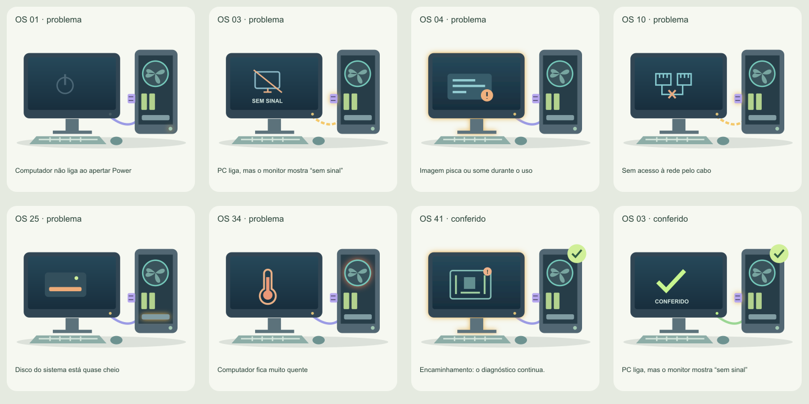

# Estados da bancada · v2.0.0

Prancha renderizada diretamente dos SVGs usados no jogo, com exemplos de energia, vídeo, rede, armazenamento, temperatura, encaminhamento e atendimento conferido. Não é uma captura de navegador e não verifica layout responsivo ou desempenho.

Regenerar: `node scripts/render-bench-review.mjs`.
